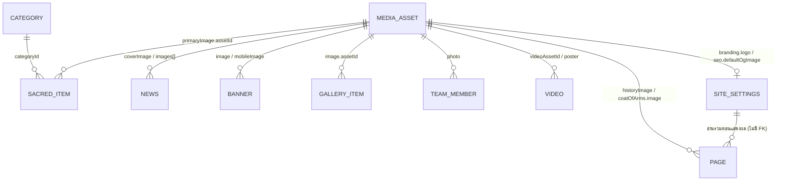

# ข้อกำหนด MongoDB Schema (MongoDB Schema Specification)

**Phase:** 02.5.2 — Legacy Admin Data Mapping
**วันที่:** 19 ตุลาคม 2569 (2026-10-19)
**สถานะ:** เอกสารออกแบบเท่านั้น โค้ดในเอกสารนี้เป็น **ตัวอย่างข้อกำหนด** ยังไม่ได้สร้างไฟล์ใน `src/models/` ยังไม่ได้ติดตั้ง `mongoose` และยังไม่ได้เชื่อมต่อ MongoDB Atlas

เอกสารนี้แทนที่ข้อเสนอ schema ใน [`media-migration-plan.md`](media-migration-plan.md) §3 ที่เขียนก่อนได้รับรายงาน Admin audit ที่มาของแต่ละฟิลด์ดูได้ใน [`legacy-data-mapping.md`](legacy-data-mapping.md)

## 1. ข้อตกลง (conventions)

| เรื่อง | ข้อกำหนด |
|---|---|
| ชื่อ collection | snake_case พหูพจน์ ระบุใน option `collection` เสมอ (ไม่ให้ Mongoose ตั้งชื่ออัตโนมัติ) |
| ชื่อ model | PascalCase เอกพจน์ เช่น `SacredItem` |
| ชื่อฟิลด์ | camelCase ภาษาอังกฤษ |
| เวลา | `timestamps: true` (`createdAt`, `updatedAt`) |
| การแก้พร้อมกัน | `optimisticConcurrency: true` (ใช้ `__v` เป็น version) |
| ไฟล์ model | `src/models/<kebab-name>.js` ใช้รูปแบบ `models.X ?? model("X", schema)` เพื่อไม่ให้ประกาศซ้ำตอน hot reload |
| การเข้าถึง | อ่าน/เขียนผ่าน `src/services/*` ฝั่งเซิร์ฟเวอร์เท่านั้น ไม่ query จาก component |
| ข้อความยาว | `body` เป็น string รูปแบบ `legacy-text-v1` (บรรทัดว่าง = ย่อหน้า, `**ตัวหนา**`) ไม่เก็บ HTML |
| วันที่แบบไม่มีเวลา | string `YYYY-MM-DD` (เช่น วันที่ข่าว) เพื่อไม่ให้เลื่อนวันจาก timezone |
| slug | `^[a-z0-9]+(?:-[a-z0-9]+)*$` รองรับ slug เดิมทั้ง 8 ตัว |
| เพดานอักษร | ใช้ `maxlength` ตามที่ UI ระบบเดิมแสดง (ตัวเลขในวงเล็บใน mapping) |
| การลบ | ไม่มี hard delete จาก importer, CMS ใช้ `status: "archived"` หรือ soft delete (`deletedAt`) ตามที่ตัดสินใจภายหลัง |

## 2. Sub-schema ที่ใช้ร่วมกัน

```js
import { Schema } from "mongoose";

const slugPattern = /^[a-z0-9]+(?:-[a-z0-9]+)*$/;
const isoDatePattern = /^\d{4}-\d{2}-\d{2}$/;

// ภาพที่ใช้ในเนื้อหา: alt/caption/focal point เป็นค่าระดับการใช้งาน
export const ImageRefSchema = new Schema(
  {
    assetId: { type: Schema.Types.ObjectId, ref: "MediaAsset", default: null },
    alt: { type: String, trim: true, maxlength: 250, default: "" },
    caption: { type: String, trim: true, maxlength: 120, default: null },
    focalPoint: {
      x: { type: Number, min: 0, max: 1 },
      y: { type: Number, min: 0, max: 1 },
    },
    mediaMapping: {
      status: { type: String, enum: ["resolved", "pending", "missing"], default: "resolved" },
      legacyMediaId: { type: String, default: null },
      legacyUrl: { type: String, default: null },
    },
  },
  { _id: false },
);

export const SeoSchema = new Schema(
  {
    title: { type: String, trim: true, maxlength: 60, default: null },
    description: { type: String, trim: true, maxlength: 155, default: null },
  },
  { _id: false },
);

// ธงข้อมูลตัวอย่างระดับฟิลด์ (จากหน้า /placeholders ของระบบเดิม)
export const PlaceholderFieldSchema = new Schema(
  {
    path: { type: String, required: true },          // เช่น "body", "wishTopics.wish-02.description"
    status: { type: String, enum: ["placeholder", "confirmed_correct", "replaced"], required: true },
    source: { type: String, enum: ["legacy", "public_text_marker", "new_cms"], required: true },
    legacyPath: { type: String, default: null },
    note: { type: String, maxlength: 300, default: null },
    flaggedAt: { type: Date, required: true },
    resolvedAt: { type: Date, default: null },
    resolvedBy: { type: Schema.Types.ObjectId, ref: "User", default: null },
  },
  { _id: false },
);

// ข้อมูลอ้างอิงระบบเดิม
export const LegacySchema = new Schema(
  {
    system: { type: String, default: "sanpudam168-workers" },
    module: { type: String, required: true },        // เช่น "sacredItems"
    id: { type: String, default: null },             // legacy ID ถ้ามี
    key: { type: String, required: true },           // คีย์ idempotent (legacy-data-mapping §12)
    keyStrength: { type: String, enum: ["id", "slug", "singleton", "hash"], required: true },
    isPublished: { type: Boolean, default: null },   // ความตั้งใจเผยแพร่เดิม
    sortOrder: { type: Number, default: null },
    checksum: { type: String, required: true },      // SHA-256 ของข้อมูลต้นทางที่ normalize แล้ว
    sourceType: { type: String, enum: ["export", "manual_transcription", "public_site"], required: true },
    sourceUrl: { type: String, default: null },
    raw: { type: Schema.Types.Mixed, default: null }, // ค่าดิบที่แปลงไม่ได้ (ไม่มีข้อมูลบุคคลหรือความลับ)
  },
  { _id: false },
);

export const MigrationSchema = new Schema(
  {
    runId: { type: String, required: true },
    importedAt: { type: Date, required: true },
    editedAfterImport: { type: Boolean, default: false },
  },
  { _id: false },
);

export const ReviewStateSchema = new Schema(
  {
    status: { type: String, enum: ["pending_review", "approved", "changes_requested"], default: "pending_review" },
    reviewedBy: { type: Schema.Types.ObjectId, ref: "User", default: null },
    reviewedAt: { type: Date, default: null },
    note: { type: String, maxlength: 500, default: null },
  },
  { _id: false },
);

export const ConsentSchema = new Schema(
  {
    status: { type: String, enum: ["not_required", "pending", "obtained", "refused"], default: "pending" },
    recordedAt: { type: Date, default: null },
    note: { type: String, maxlength: 300, default: null },
  },
  { _id: false },
);

// ฟิลด์ร่วมของทุกเอกสารเนื้อหา
export const contentFields = {
  status: { type: String, enum: ["draft", "published", "archived"], default: "draft", index: true },
  review: { type: ReviewStateSchema, default: () => ({}) },
  placeholderFields: { type: [PlaceholderFieldSchema], default: [] },
  legacy: { type: LegacySchema, default: null },
  migration: { type: MigrationSchema, default: null },
  createdBy: { type: Schema.Types.ObjectId, ref: "User", default: null },
  updatedBy: { type: Schema.Types.ObjectId, ref: "User", default: null },
};
```

## 3. Collections

ทุก schema ใช้ option `{ collection: "<name>", timestamps: true, optimisticConcurrency: true }` และรวม `...contentFields` (ยกเว้น `media_assets` และ `migration_runs` ที่มีฟิลด์ของตัวเอง)

### 3.1 `site_settings` — model `SiteSettings` (singleton)

```js
const SiteSettingsSchema = new Schema({
  key: { type: String, enum: ["default"], default: "default", unique: true },
  identity: {
    name: { type: String, required: true, maxlength: 60 },
    shortName: { type: String, required: true, maxlength: 30 },
    tagline: { type: String, maxlength: 80, default: null },
    description: { type: String, required: true, maxlength: 400 },
  },
  branding: {
    logo: { type: ImageRefSchema, default: null },
  },
  contact: {
    address: { type: String, required: true, maxlength: 200 },
    locationShort: { type: String, required: true, maxlength: 80 },
    phoneNumber: { type: String, default: null },        // ชื่อเดียวกับ src/config/site.js
    lineId: { type: String, default: null },             // ค่าหลัก; lineInquiryUrl สร้างตอนอ่าน
    directionsUrl: { type: String, default: null },      // ชื่อเดียวกับ src/config/site.js; ตรวจด้วย getMapsUrl()
    mapEmbedQuery: { type: String, maxlength: 120, default: null },
    verified: { type: Boolean, default: false },
  },
  openingHours: {
    opens: { type: String, match: /^([01]\d|2[0-3]):[0-5]\d$/, required: true },
    closes: { type: String, match: /^([01]\d|2[0-3]):[0-5]\d$/, required: true },
    daysOfWeek: { type: [String], enum: ["mon", "tue", "wed", "thu", "fri", "sat", "sun"], default: [] },
    daysText: { type: String, required: true, maxlength: 40 },
    displayText: { type: String, required: true, maxlength: 60 },
  },
  socialLinks: [{
    _id: false,
    platform: { type: String, enum: ["facebook", "tiktok", "youtube"], required: true },
    url: { type: String, required: true },
    verified: { type: Boolean, default: false },
  }],
  contactTopics: [{
    _id: false,
    key: { type: String, required: true },
    label: { type: String, required: true, maxlength: 60 },
    sortOrder: { type: Number, required: true },
  }],
  seo: {
    defaultOgImage: { type: ImageRefSchema, default: null },   // 1200×630
  },
  analytics: {                                                  // ไม่ย้ายโดยค่าเริ่มต้น
    gaMeasurementId: { type: String, match: /^G-[A-Z0-9]+$/, default: null },
    googleAdsId: { type: String, match: /^AW-\d+$/, default: null },
    metaPixelId: { type: String, match: /^\d+$/, default: null },
    enabled: { type: Boolean, default: false },                 // เปิดได้เมื่อมี consent mechanism
  },
  ...contentFields,
}, { collection: "site_settings", timestamps: true, optimisticConcurrency: true });
```

`lineInquiryUrl` ไม่ถูกเก็บ บริการอ่านข้อมูลสร้างค่า `https://line.me/R/ti/p/<lineId>` แล้วส่งให้ `getContactActions()` ซึ่งตรวจรูปแบบด้วย `getLineUrl()`

### 3.2 `pages` — model `Page`

ระยะแรกมีเอกสารเดียว `key: "history"` (มาจาก `aboutPage` ของระบบเดิม) หน้า `/` และ `/visit` ประกอบจาก `site_settings`, `banners`, `gallery_items`, `faqs` และ `pages[history]` ไม่มีเอกสารของตัวเอง

```js
const ListItemBase = { _id: false, key: { type: String, required: true }, sortOrder: { type: Number, required: true } };

const PageSchema = new Schema({
  key: { type: String, enum: ["history"], required: true, unique: true },
  title: { type: String, required: true, maxlength: 80 },
  intro: { type: String, required: true, maxlength: 500 },
  historyBody: { type: String, required: true, maxlength: 8000 },
  historyImage: { type: ImageRefSchema, default: null },
  quote: { type: String, maxlength: 140, default: null },
  homeIntroHeading: { type: String, required: true, maxlength: 40 },
  coatOfArms: {
    heading: { type: String, required: true, maxlength: 80 },
    body: { type: String, required: true, maxlength: 8000 },
    image: { type: ImageRefSchema, default: null },
    parts: [{ ...ListItemBase,
      part: { type: String, required: true, maxlength: 80 },
      meaning: { type: String, required: true, maxlength: 300 } }],
  },
  wishTopics: [{ ...ListItemBase,
    topic: { type: String, required: true, maxlength: 40 },
    description: { type: String, maxlength: 140, default: null },
    icon: { type: String, required: true,
      enum: ["arrow-up", "graduation-cap", "briefcase", "document", "coin", "crown", "shield"] } }],
  worshipSteps: [{ ...ListItemBase,
    title: { type: String, required: true, maxlength: 80 },
    detail: { type: String, maxlength: 300, default: null } }],
  bodyFormat: { type: String, enum: ["legacy-text-v1"], default: "legacy-text-v1" },
  seo: { type: SeoSchema, default: () => ({}) },
  ...contentFields,
}, { collection: "pages", timestamps: true, optimisticConcurrency: true });
```

### 3.3 `categories` — model `Category`

```js
const CategorySchema = new Schema({
  name: { type: String, required: true, trim: true, maxlength: 40 },
  slug: { type: String, required: true, match: slugPattern, unique: true },   // ใช้ใน /sakkara?cat=<slug>
  description: { type: String, maxlength: 300, default: null },
  sortOrder: { type: Number, required: true, default: 0 },
  ...contentFields,
}, { collection: "categories", timestamps: true, optimisticConcurrency: true });
```

### 3.4 `sacred_items` — model `SacredItem`

```js
const SacredItemSchema = new Schema({
  name: { type: String, required: true, trim: true, maxlength: 80 },
  slug: { type: String, required: true, match: slugPattern, unique: true },   // /sakkara/<slug>
  type: { type: String, enum: ["shrine_worship", "sacred_object"], required: true },
  categoryId: { type: Schema.Types.ObjectId, ref: "Category", default: null, index: true },
  categoryMapping: {                                       // legacy-data-mapping §6
    status: { type: String, enum: ["resolved", "unresolved", "owner_confirmed"], default: "resolved" },
    legacyValue: { type: String, default: null },
    observedPublicSlug: { type: String, default: null },   // หลักฐานจากหน้าเว็บ ไม่ใช่ค่าอ้างอิง
  },
  primaryImage: { type: ImageRefSchema, required: true },
  excerpt: { type: String, required: true, maxlength: 220 },
  body: { type: String, maxlength: 8000, default: null },
  bodyFormat: { type: String, enum: ["legacy-text-v1"], default: "legacy-text-v1" },
  prayerTopics: { type: String, maxlength: 160, default: null },
  offerings: { type: String, maxlength: 400, default: null },
  inquiryText: { type: String, maxlength: 120, default: null },   // เดิม offeringPriceText; ไม่ใช่ราคา
  variants: [{
    _id: false,
    key: { type: String, required: true },
    name: { type: String, required: true, maxlength: 60 },
    quantity: { type: Number, min: 0, default: null },
    quantityText: { type: String, maxlength: 40, default: null },   // เมื่อแปลงเป็นตัวเลขไม่ได้
    note: { type: String, maxlength: 60, default: null },
    sortOrder: { type: Number, required: true },
  }],
  showVariantQuantities: { type: Boolean, default: false },   // ซ่อนจำนวนจัดสร้างจนกว่าเจ้าของยืนยัน (IA)
  sortOrder: { type: Number, required: true, default: 0 },
  seo: { type: SeoSchema, default: () => ({}) },
  ...contentFields,
}, { collection: "sacred_items", timestamps: true, optimisticConcurrency: true });

SacredItemSchema.index({ status: 1, sortOrder: 1 });
SacredItemSchema.index({ categoryId: 1, status: 1, sortOrder: 1 });
```

ไม่มีฟิลด์ราคาตัวเลข สต็อก ตะกร้า หรือคำสั่งซื้อ

### 3.5 `news` — model `News`

```js
const NewsSchema = new Schema({
  title: { type: String, required: true, trim: true, maxlength: 120 },
  slug: { type: String, required: true, match: slugPattern, unique: true },   // /news/<slug>
  date: { type: String, required: true, match: isoDatePattern },            // date-only
  coverImage: { type: ImageRefSchema, required: true },
  excerpt: { type: String, required: true, maxlength: 220 },
  body: { type: String, required: true, maxlength: 15000 },
  bodyFormat: { type: String, enum: ["legacy-text-v1"], default: "legacy-text-v1" },
  images: [{ type: ImageRefSchema }],                                        // ลำดับตาม array
  seo: { type: SeoSchema, default: () => ({}) },
  ...contentFields,
}, { collection: "news", timestamps: true, optimisticConcurrency: true });

NewsSchema.index({ status: 1, date: -1 });
```

### 3.6 `gallery_items` — model `GalleryItem`

```js
const GalleryItemSchema = new Schema({
  galleryKey: { type: String, default: "shrine-main", index: true },
  image: { type: ImageRefSchema, required: true },      // caption ≤ 120
  sortOrder: { type: Number, required: true, default: 0 },
  ...contentFields,
}, { collection: "gallery_items", timestamps: true, optimisticConcurrency: true });

GalleryItemSchema.index({ galleryKey: 1, status: 1, sortOrder: 1 });
```

### 3.7 `banners` — model `Banner`

```js
const BannerSchema = new Schema({
  image: { type: ImageRefSchema, required: true },       // 3:2, caption ≤ 40 (required), focalPoint 0–1
  mobileImage: { type: ImageRefSchema, default: null },  // ใหม่ ระบบเดิมไม่มี
  sortOrder: { type: Number, required: true, default: 0 },
  ...contentFields,
}, { collection: "banners", timestamps: true, optimisticConcurrency: true });

BannerSchema.index({ status: 1, sortOrder: 1 });
BannerSchema.path("image").validate((v) => Boolean(v?.caption), "caption is required for banners");
```

### 3.8 `videos` — model `Video`

```js
const VideoSchema = new Schema({
  title: { type: String, required: true, maxlength: 80 },
  videoAssetId: { type: Schema.Types.ObjectId, ref: "MediaAsset", default: null },  // required ก่อนเผยแพร่
  posterMode: { type: String, enum: ["auto", "custom"], default: "auto" },
  poster: { type: ImageRefSchema, default: null },
  description: { type: String, maxlength: 300, default: null },
  sortOrder: { type: Number, required: true, default: 0 },
  ...contentFields,
}, { collection: "videos", timestamps: true, optimisticConcurrency: true });
```

`videoAssetId` อนุญาตให้เป็น `null` ตอนเป็น draft (ระบบเดิมมีรายการที่ยังไม่มีไฟล์) แต่ publish validation ต้องบังคับ

### 3.9 `reviews` — model `Review`

```js
const ReviewSchema = new Schema({
  displayName: { type: String, required: true, maxlength: 40 },
  sourceLabel: { type: String, maxlength: 60, default: null },
  quote: { type: String, required: true, maxlength: 500 },
  rating: { type: Number, min: 1, max: 5, default: null },
  consent: { type: ConsentSchema, default: () => ({ status: "pending" }) },
  sortOrder: { type: Number, required: true, default: 0 },
  ...contentFields,
}, { collection: "reviews", timestamps: true, optimisticConcurrency: true });
```

### 3.10 `faqs` — model `Faq`

```js
const FaqSchema = new Schema({
  question: { type: String, required: true, maxlength: 140 },
  answer: { type: String, required: true, maxlength: 800 },
  showOnHome: { type: Boolean, default: false },
  sortOrder: { type: Number, required: true, default: 0 },
  ...contentFields,
}, { collection: "faqs", timestamps: true, optimisticConcurrency: true });

FaqSchema.index({ status: 1, sortOrder: 1 });
FaqSchema.index({ showOnHome: 1, status: 1, sortOrder: 1 });
```

### 3.11 `team_members` — model `TeamMember`

```js
const TeamMemberSchema = new Schema({
  name: { type: String, required: true, maxlength: 60 },
  roleTitle: { type: String, required: true, maxlength: 60 },
  photo: { type: ImageRefSchema, default: null },          // 1:1
  bio: { type: String, maxlength: 300, default: null },
  consent: { type: ConsentSchema, default: () => ({ status: "pending" }) },
  sortOrder: { type: Number, required: true, default: 0 },
  ...contentFields,
}, { collection: "team_members", timestamps: true, optimisticConcurrency: true });
```

`team_members` เป็นข้อมูลแสดงบนหน้าเว็บ **ไม่ใช่บัญชีผู้ใช้** และไม่มีความสัมพันธ์กับ `users`

### 3.12 `media_assets` — model `MediaAsset`

```js
const MediaAssetSchema = new Schema({
  manifestId: { type: String, unique: true, sparse: true },     // จาก reference-media-manifest.json
  category: { type: String, required: true,
    enum: ["branding", "shrine-place", "shrine-sacred-object", "sacred-item", "event", "editorial", "shrine-people", "page", "video"] },
  resourceType: { type: String, enum: ["image", "video"], required: true },
  cloudinary: {
    publicId: { type: String, required: true, unique: true },
    assetId: { type: String, default: null },
    version: { type: Number, required: true },
    secureUrl: { type: String, required: true },
    format: { type: String, required: true },
    etag: { type: String, default: null },                      // MD5 จาก Cloudinary
  },
  width: { type: Number, default: null },
  height: { type: Number, default: null },
  duration: { type: Number, default: null },                    // วิดีโอ (วินาที)
  bytes: { type: Number, required: true },
  mimeType: { type: String, required: true },
  contentHash: {
    sha256: { type: String, required: true, unique: true },
    md5: { type: String, default: null },
    dhash: { type: String, default: null },
  },
  defaultAlt: { type: String, maxlength: 250, default: null }, // ค่าตั้งต้นของ media picker เท่านั้น
  defaultFocalPoint: { x: { type: Number, min: 0, max: 1 }, y: { type: Number, min: 0, max: 1 } },
  source: {
    type: { type: String, enum: ["reference-site", "legacy-export", "owner-upload", "cms-upload"], required: true },
    url: { type: String, default: null },
    originalFilename: { type: String, default: null },
    pages: { type: [String], default: [] },
  },
  legacy: { mediaIds: { type: [String], default: [] } },
  rights: {
    status: { type: String, enum: ["pending_owner_confirmation", "approved", "restricted", "rejected"],
      default: "pending_owner_confirmation" },
    owner: { type: String, default: null },
    license: { type: String, default: null },
    containsIdentifiablePeople: { type: Boolean, default: false },
    consent: { type: ConsentSchema, default: () => ({ status: "not_required" }) },
    notes: { type: [String], default: [] },
  },
  approval: {
    status: { type: String, enum: ["pending", "approved", "rejected"], default: "pending" },
    approvedBy: { type: Schema.Types.ObjectId, ref: "User", default: null },
    approvedAt: { type: Date, default: null },
  },
  tags: { type: [String], default: [] },                        // เช่น "used-in:news", "source:reference-site"
  importedAt: { type: Date, default: null },
  migration: { type: MigrationSchema, default: null },
  deletedAt: { type: Date, default: null },
}, { collection: "media_assets", timestamps: true, optimisticConcurrency: true });

MediaAssetSchema.index({ "source.url": 1 }, { unique: true, sparse: true });
MediaAssetSchema.index({ "legacy.mediaIds": 1 });
MediaAssetSchema.index({ category: 1, "rights.status": 1 });
```

### 3.13 `migration_runs` — model `MigrationRun`

```js
const MigrationRunSchema = new Schema({
  runId: { type: String, required: true, unique: true },
  track: { type: String, enum: ["media", "site_settings", "content"], required: true },
  mode: { type: String, enum: ["dry_run", "apply"], required: true },
  planHash: { type: String, required: true },
  sourceType: { type: String, enum: ["export", "manual_transcription", "public_site"], required: true },
  sourceChecksum: { type: String, required: true },
  startedAt: { type: Date, required: true },
  finishedAt: { type: Date, default: null },
  operator: { type: String, default: null },                   // ชื่อผู้รัน (ไม่ใช่ credential)
  counts: {
    created: Number, unchanged: Number, legacyChanged: Number,
    conflict: Number, invalid: Number, skipped: Number, failed: Number,
  },
  items: [{
    _id: false,
    collection: String, legacyKey: String, result: String, message: String,  // message ผ่านการ redact
  }],
}, { collection: "migration_runs", timestamps: true });
```

ห้ามบันทึกค่า environment, connection string, API key, ลายเซ็นคำขอ หรือ response แบบเต็ม

### 3.14 Collections ในอนาคต (ไม่รับข้อมูลจากระบบเดิม)

| Collection | หมายเหตุ |
|---|---|
| `contact_messages` | สร้างเมื่อทำ Contact Form พร้อมนโยบายความเป็นส่วนตัว สิทธิ์อ่านแยก และ retention **ไม่ย้ายข้อความเดิม** |
| `audit_logs` | `actorId`, `action`, `entityType`, `entityId`, `changes` (redact ความลับ), `createdAt` พร้อม TTL ตามนโยบายที่อนุมัติ **ไม่ย้าย log เดิม** โดยค่าเริ่มต้น |
| `users`, `accounts`, `sessions`, `verification_tokens` | ตามกลยุทธ์ Auth.js และ adapter ที่เลือก **ไม่ย้ายบัญชี รหัสผ่าน หรือ session เดิม** และไม่ใช้ `team_members` เป็นบัญชี |

## 4. ความสัมพันธ์



| ความสัมพันธ์ | รูปแบบ | กฎความถูกต้อง |
|---|---|---|
| **Sacred Items → Categories** | `sacred_items.categoryId` → `categories._id` (หลายต่อหนึ่ง, nullable ระหว่างนำเข้า) | ห้ามลบหมวดที่ยังมีรายการอ้างอิง ต้องย้ายหมวดก่อน (application-level check) รายการที่ `categoryId = null` เผยแพร่ไม่ได้ ตัวกรอง `?cat=` ใช้ `categories.slug` |
| **News → Media** | `coverImage.assetId` (หนึ่ง) + `images[].assetId` (หลาย, มีลำดับ) | `coverImage` ต้อง resolve ได้ก่อนเผยแพร่ alt/caption อยู่ใน ImageRef |
| **Banners → Media** | `image.assetId` (+ `mobileImage`) พร้อม `focalPoint` | caption required, focal point 0–1 |
| **Gallery → Media** | `gallery_items.image.assetId` หนึ่งต่อหนึ่งรายการ จัดกลุ่มด้วย `galleryKey` | ภาพเดียวอยู่ในหลายแกลเลอรีได้โดยไม่ซ้ำไฟล์ |
| **Pages ↔ Site Settings** | ไม่มี foreign key `pages[history]` เก็บเฉพาะเนื้อหาของหน้า ข้อมูลส่วนกลาง (ชื่อ ที่อยู่ เวลา ติดต่อ) อ่านจาก `site_settings` ตอนแสดงผลเสมอ | ห้ามคัดลอกข้อมูลติดต่อหรือเวลาเปิดลงใน `pages` หรือ `sacred_items` (เช่น เวลาเปิดในหน้ารายละเอียดมาจาก settings) |
| **Media usage** | หาจากการ query ย้อนกลับ (`*.assetId`) ไม่เก็บ usage list ซ้ำใน asset | ก่อนลบ asset ต้องตรวจว่าไม่มีการอ้างอิง รายงาน orphan asset |

Index สำหรับ query ย้อนกลับของสื่อ: `{ "primaryImage.assetId": 1 }` ใน `sacred_items`, `{ "coverImage.assetId": 1 }` และ `{ "images.assetId": 1 }` ใน `news`, `{ "image.assetId": 1 }` ใน `banners` และ `gallery_items`

## 5. Index ที่ใช้ร่วมสำหรับการนำเข้า

ทุก collection เนื้อหาและ singleton:

```js
schema.index({ "legacy.key": 1 }, { unique: true, partialFilterExpression: { "legacy.key": { $type: "string" } } });
schema.index({ "legacy.module": 1, "legacy.id": 1 }, { unique: true, partialFilterExpression: { "legacy.id": { $type: "string" } } });
schema.index({ "placeholderFields.status": 1 });
schema.index({ "review.status": 1, status: 1 });
```

## 6. Validation สองระดับ

| ระดับ | ใช้เมื่อ | กฎ |
|---|---|---|
| **Draft validation** (Mongoose schema) | บันทึกทุกครั้ง รวมถึงการนำเข้า | ชนิดข้อมูล, `maxlength`, enum, รูปแบบ slug/วันที่ อนุญาต `assetId: null` และ `categoryId: null` |
| **Publish validation** (service ก่อนเปลี่ยน `status` เป็น `published`) | ตอนเผยแพร่ | required ตาม UI เดิมครบ, สื่อ required resolve ได้, ไม่มีธง `placeholder` ค้าง, `review.status = approved`, `categoryMapping.status ≠ unresolved`, `consent.status = obtained` (reviews/team/ภาพบุคคล), `rights.status = approved` ของสื่อที่ใช้, `inquiryText` ไม่มีราคาตัวเลข และ `showVariantQuantities` เปิดได้เมื่อเจ้าของยืนยันแล้วเท่านั้น |

การแยกสองระดับทำให้นำเข้าข้อมูลที่ยังไม่สมบูรณ์เป็น draft ได้ โดยไม่เผยแพร่ข้อมูลที่ยังไม่ผ่าน
